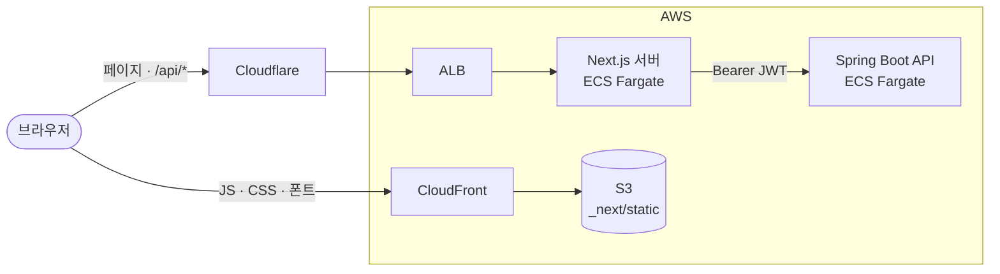

<div align="center">

# SHG trip

대화로 여행 조건을 정하면 하루 단위 일정을 만들어 주는 여행 플래너

[myshgtrip.com](https://myshgtrip.com) · [추천 코스](https://myshgtrip.com/trips) · [백엔드](https://github.com/byunggwan-kim0918/shg-trip-back)

<a href="https://myshgtrip.com">
  <picture>
    <source media="(prefers-color-scheme: dark)" srcset="docs/images/result-dark.png">
    
  </picture>
</a>

<picture>
  <source media="(prefers-color-scheme: dark)" srcset="docs/images/chat-dark.png">
  
</picture>
<picture>
  <source media="(prefers-color-scheme: dark)" srcset="docs/images/course-dark.png">
  
</picture>

</div>

SHG trip은 여행지, 날짜, 동행, 취향을 대화로 물어보고 동선과 방문 시각까지 정한 일정을 만들어 주는 서비스입니다. 이 저장소는 웹 프론트엔드이고, 일정 생성은 [shg-trip-back](https://github.com/byunggwan-kim0918/shg-trip-back)에서 합니다.

## 기능

- 대화로 여행 조건 입력, 확인 화면에서 항목별 수정
- 생성 중 완성된 날짜부터 바로 표시
- 타임라인과 지도로 일정 보기
- 드래그로 순서 변경, 방문지 삭제와 대안 교체
- 로그인 없이 보는 공유 링크
- 국내와 일본 도시별 추천 코스

## 구조



브라우저는 백엔드를 직접 부르지 않습니다. API 요청과 SSE 구독은 모두 Next.js Route Handler(`/api/proxy`)를 거치고, JWT는 암호화된 HttpOnly 쿠키에만 있습니다.

JS와 CSS는 S3와 CloudFront에서 받습니다. 이전 빌드 파일을 지우지 않기 때문에 배포 중에도 열려 있던 탭이 깨지지 않습니다.

추천 코스는 운영 생성 파이프라인으로 만든 일정을 검수해 `content/trips`에 JSON으로 두고, 빌드할 때 정적 페이지로 만듭니다.

## 로컬 실행

```bash
npm install
npm run dev   # http://localhost:3000, 백엔드 http://localhost:8080 필요
```

`.env.local` 키와 테스트 명령은 [AGENTS.md](AGENTS.md)에 있습니다.

## 기술 스택

- [Next.js 16](https://nextjs.org) – 프레임워크
- [React 19](https://react.dev) – UI
- [TypeScript](https://www.typescriptlang.org) – 언어
- [Tailwind CSS 4](https://tailwindcss.com) – 스타일
- [Zustand](https://zustand.docs.pmnd.rs) – 상태 관리
- [MapLibre GL](https://maplibre.org) + [OpenFreeMap](https://openfreemap.org) – 지도
- [dnd-kit](https://dndkit.com) – 드래그 앤 드롭
- [Playwright](https://playwright.dev) – E2E 테스트
- AWS ECS Fargate, S3, CloudFront – 배포

## 라이선스

All rights reserved. [LICENSE.md](LICENSE.md)
