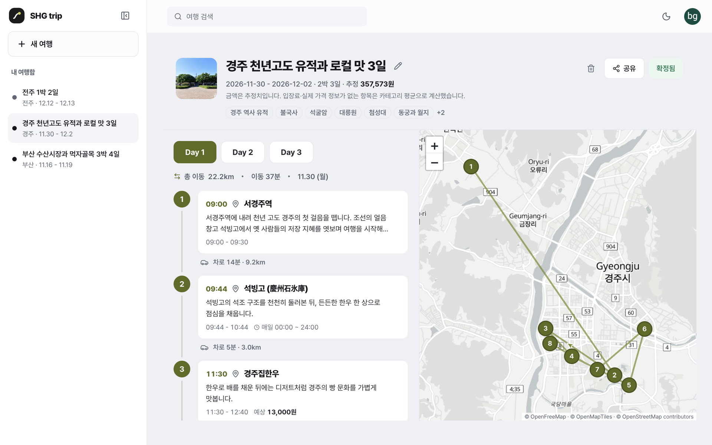
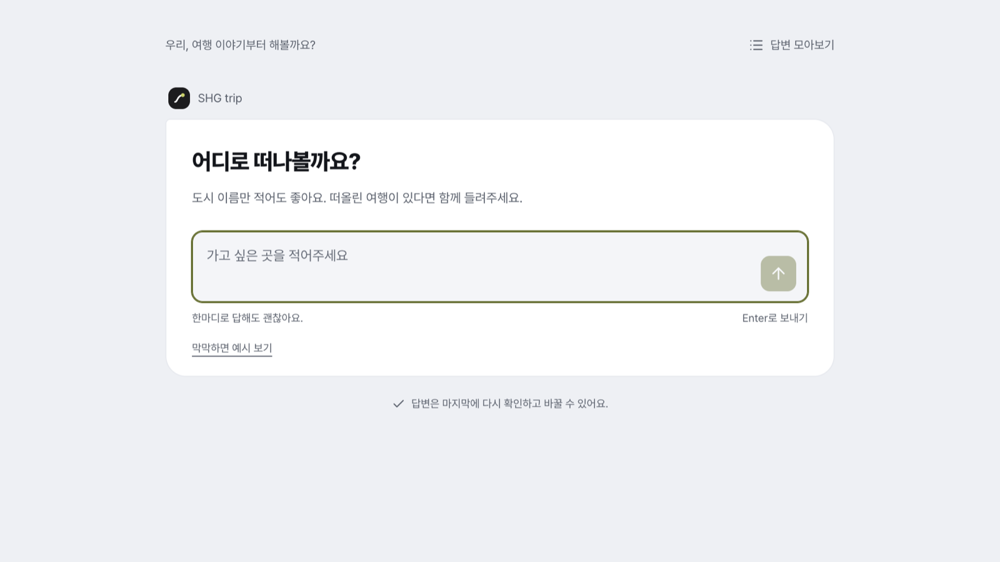
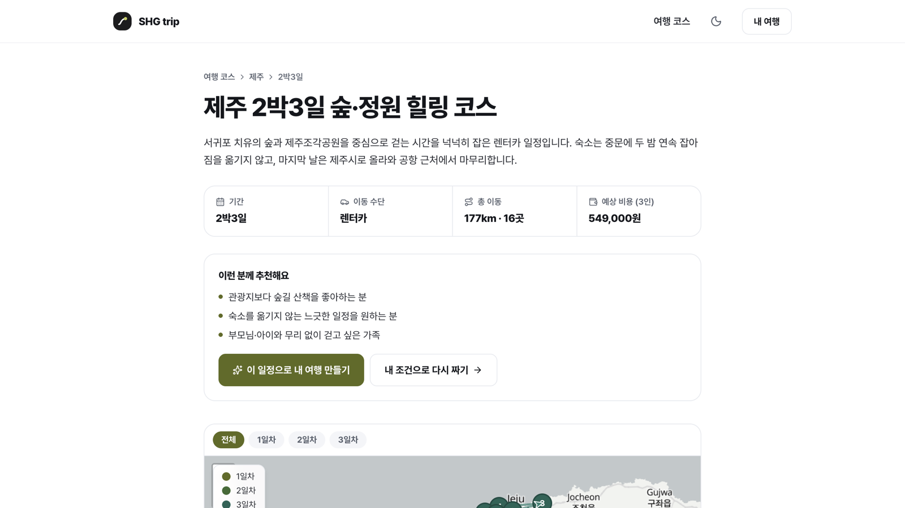
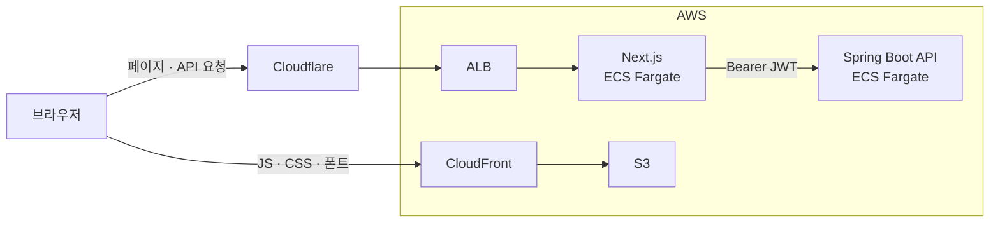

# SHG trip

대화로 만드는 나만의 여행 일정

[서비스](https://myshgtrip.com) · [추천 코스](https://myshgtrip.com/trips) · [백엔드](https://github.com/byunggwan-kim0918/shg-trip-back)

<a href="https://myshgtrip.com">
  <picture>
    <source media="(prefers-color-scheme: dark)" srcset="docs/images/result-dark.png">
    
  </picture>
</a>

<picture>
  <source media="(prefers-color-scheme: dark)" srcset="docs/images/chat-dark.png">
  
</picture>
<picture>
  <source media="(prefers-color-scheme: dark)" srcset="docs/images/course-dark.png">
  
</picture>

SHG trip의 Next.js 웹 프론트엔드입니다. 여행지, 날짜, 동행, 취향을 대화로 입력하면 동선과 방문 시간이 포함된 일정을 확인하고 수정할 수 있습니다. 국내와 일본 여행지를 지원하며, 일정 생성은 [백엔드](https://github.com/byunggwan-kim0918/shg-trip-back)에서 처리합니다.

## 주요 기능

- **여행 조건 입력** — 대화로 조건을 정리하고, 확인 화면에서 항목별로 수정합니다.
- **생성 중인 일정 확인** — 전체 생성이 끝나기 전에도 완성된 날짜부터 확인할 수 있습니다.
- **타임라인과 지도** — 날짜별 방문 시간과 이동 동선을 함께 보여줍니다.
- **일정 편집** — 드래그로 방문 순서를 바꾸거나, 방문지를 삭제하고 다른 장소로 교체합니다.
- **일정 공유** — 로그인 없이 열람할 수 있는 공유 링크를 제공합니다.
- **추천 코스** — 국내와 일본 도시별로 미리 구성된 여행 일정을 둘러볼 수 있습니다.

## 서비스 구조

## 주요 설계

### API 요청과 인증

API 요청과 SSE 연결은 Next.js Route Handler(`/api/proxy`)를 거칩니다. JWT는 암호화된 HttpOnly 쿠키로 관리하고, Next.js 서버가 백엔드 요청에 인증 정보를 전달합니다.

### 배포 전후 정적 파일 유지

JS, CSS, 폰트는 S3와 CloudFront로 제공합니다. 배포 후에도 이전 빌드 파일을 유지해, 이미 열려 있는 페이지에서 필요한 파일을 계속 불러올 수 있도록 했습니다.

### 추천 코스 정적 페이지

추천 코스는 일정 생성 파이프라인으로 만든 결과를 검수해 제공합니다. 코스 데이터는 `content/trips`에 JSON으로 관리하고, 빌드 시 정적 페이지로 생성합니다.

## 기술 스택

| 구분 | 기술 |
| --- | --- |
| 프레임워크·UI | Next.js 16, React 19 |
| 언어 | TypeScript |
| 스타일 | Tailwind CSS 4 |
| 상태 관리 | Zustand |
| 지도 | MapLibre GL, OpenFreeMap |
| 드래그 앤 드롭 | dnd-kit |
| E2E 테스트 | Playwright |
| 배포 | AWS ECS Fargate, S3, CloudFront |

## 라이선스

All rights reserved. [LICENSE.md](LICENSE.md)
